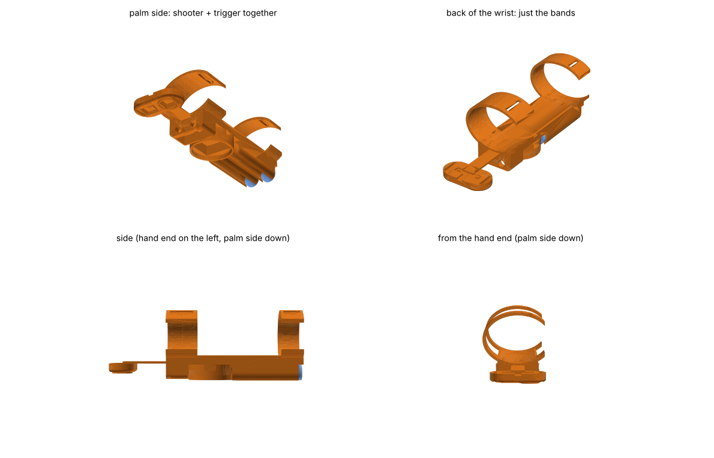
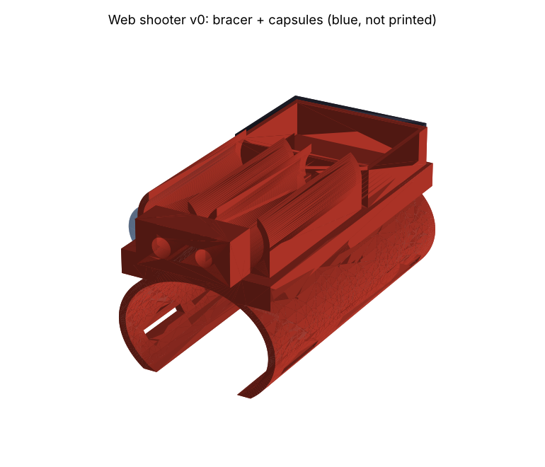

# CAD

## v1: minimal (current)

[`webshooter_v1.py`](webshooter_v1.py), based on the [early Tinkercad prototype](reference/README.md). A low spine on two slim C-bands: nozzles + valves at the wrist, a round 1.28" screen with the electronics underneath, and twin capsules behind.

- `stl/v1_wrist_unit.stl`: the whole thing, **one print**: bands, pod and palm trigger
- `stl/v1_fit_ring.stl`: a 10 mm slice of the band. **Print this first** (~15 min) to check the fit, then adjust `WRIST_WIDTH`/`WRIST_HEIGHT` by a millimeter or two if needed
- Sized for a 6 in (152 mm) wrist: band inside is 58 × 43 mm
- **Worn on the inner wrist**, like the comics: the shooter and the palm trigger are on the same side. Fire with your hand bent back (the classic thwip pose), so your palm swings out of the jet's path.
- **Palm trigger built in:** a thin flexible tongue runs from the underside of the front band to a two-button pad in your palm: **FIRE** (flush; tap = impact, hold = string) and **TETHER** (recessed with a raised ring, so you find it by feel and don't press it by accident). The tongue bends with your wrist like a spring (a *compliant mechanism*), so the buttons are part of the band without locking the wrist. An elastic loop through the pad's end slots keeps it against your palm.
- The bands open on the **pinky side** (set `GAP_SIDE = -1` for the other arm), so the palm side is solid for the tongue.
- 16 mm tall off the inner wrist, ~64 cm³ of plastic
- **Print in PETG**, not PLA: the tongue flexes every time you bend your wrist, and PLA cracks.
- Print orientation: standing on the rear band needs the fewest supports, but then the tongue's layers run across its bend and it can snap along a layer line. Printing it lying on its side is stronger but needs supports. Ask the makerspace staff, or set `TONGUE_THICK` to 1.6 for an upright print.



```bash
python webshooter_v1.py
```

**Capsules: use a sliding piston.** Each capsule has a piston that separates the fluid from the air or spring pushing it. That gives about twice the string per refill (the pressure stays steadier), and it works pointed in any direction. With plain air above the fluid, aiming upward would spray air.

---

## v0: concept (superseded)

The 3D model is **code**: [`webshooter_cad.py`](webshooter_cad.py) uses [CadQuery](https://cadquery.readthedocs.io/). Every dimension is a named parameter at the top of the file, so you can change your wrist size, capsule size and so on, then regenerate all the parts.



## Parts
| File | What | Printed? |
|---|---|---|
| `stl/bracer.stl` | Forearm shell + capsule clips + electronics tray + nozzle block | yes |
| `stl/tray_lid.stl` | Electronics cover with holes for the arm/safe switch and status LED | yes |
| `stl/palm_pad.stl` | Palm trigger pad (12 mm button) + thumb-side tether button (6 mm), strap slots | yes |
| capsules (blue) | Pressure-rated tubes, bought off the shelf | **NO: never print a pressure vessel** |

`webshooter_v0.step` is the full assembly.

## Viewing / editing without installing anything
- **GitHub:** click any `.stl` file in this folder; GitHub shows an interactive 3D viewer.
- **Tinkercad:** Create new design → Import → pick an `.stl`.
- **Onshape (free):** Import `webshooter_v0.step`.

## Regenerating
```bash
pip install cadquery matplotlib
python webshooter_cad.py      # writes stl/ and webshooter_v0.step
python render_preview.py      # writes preview/*.png
```

## Before printing at the makerspace
1. **Measure your wrist** over whatever sleeve you'll wear (width side-to-side and height top-to-bottom, ~5 cm back from the wrist bone) and update `WRIST_WIDTH` / `WRIST_HEIGHT`.
2. Update `CAPSULE_DIA` once the actual capsule tubes are chosen.
3. Print the bracer **standing on its back end** (the electronics-tray end): the shell and clips then need no supports.
4. Suggested: PETG or PLA, 20% infill, 3 walls. The v0 platform is chunky; trim it once the parts are real.
5. Cheap fit test first: set `BRACER_LENGTH = 30` and print a thin ring to check the wrist size before the full print.

## Known v0 limitations
- Capsule and electronics dimensions are placeholders until parts are picked.
- No routing channels for the tubing yet.
- No tether spool/hook at the nozzle yet (v1).
