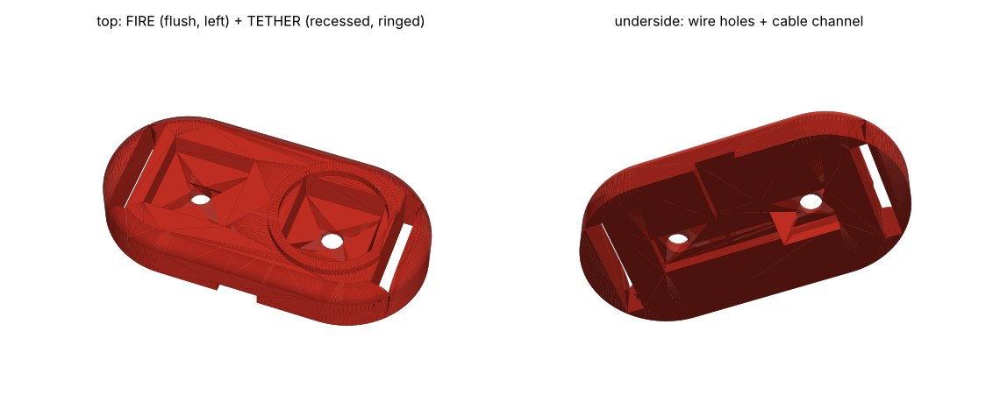

# CAD

## v1: minimal (current)

[`webshooter_v1.py`](webshooter_v1.py), based on the [early Tinkercad prototype](reference/README.md). A low spine on two slim C-bands: nozzles + valves at the wrist, a round 1.28" screen with the electronics underneath, and twin capsules behind.

- `stl/v1_wrist_unit.stl`: the whole wrist unit, one print (print standing on its rear end)
- `stl/v1_palm_pad.stl`: two-button palm pad, **FIRE** (flush; tap = impact, hold = string) and **TETHER** (recessed with a raised ring, so you find it by feel and don't press it by accident). Held by an elastic loop around the hand.
- `stl/v1_cable_clip.stl`: clips onto the front band to guide the flat cable from the palm pad



The buttons aren't on rigid arms: anything rigid crossing the wrist joint stops the wrist from bending. A thin flexible cable runs from the pad, under the wrist, to the band.
- 16 mm tall above the band, 124 mm long, ~57 cm³ of plastic


```bash
python webshooter_v1.py
```

**Capsules: use a sliding piston.** Each capsule has a piston that separates the fluid from the air or spring pushing it. That gives about twice the string per refill (the pressure stays steadier), and it works pointed in any direction. With plain air above the fluid, aiming upward would spray air.

---

## v0: concept (superseded)

The 3D model is **code**: [`webshooter_cad.py`](webshooter_cad.py) uses [CadQuery](https://cadquery.readthedocs.io/). Every dimension is a named parameter at the top of the file, so you can change your wrist size, capsule size and so on, then regenerate all the parts.


## Parts
| File | What | Printed? |
|---|---|---|
| `stl/bracer.stl` | Forearm shell + capsule clips + electronics tray + nozzle block | yes |
| `stl/tray_lid.stl` | Electronics cover with holes for the arm/safe switch and status LED | yes |
| `stl/palm_pad.stl` | Palm trigger pad (12 mm button) + thumb-side tether button (6 mm), strap slots | yes |
| capsules (blue) | Pressure-rated tubes, bought off the shelf | **NO: never print a pressure vessel** |

`webshooter_v0.step` is the full assembly.

## Viewing / editing without installing anything
- **GitHub:** click any `.stl` file in this folder; GitHub shows an interactive 3D viewer.
- **Tinkercad:** Create new design → Import → pick an `.stl`.
- **Onshape (free):** Import `webshooter_v0.step`.

## Regenerating
```bash
pip install cadquery matplotlib
python webshooter_cad.py      # writes stl/ and webshooter_v0.step
python render_preview.py      # writes preview/*.png
```

## Before printing at the makerspace
1. **Measure your wrist** over whatever sleeve you'll wear (width side-to-side and height top-to-bottom, ~5 cm back from the wrist bone) and update `WRIST_WIDTH` / `WRIST_HEIGHT`.
2. Update `CAPSULE_DIA` once the actual capsule tubes are chosen.
3. Print the bracer **standing on its back end** (the electronics-tray end): the shell and clips then need no supports.
4. Suggested: PETG or PLA, 20% infill, 3 walls. The v0 platform is chunky; trim it once the parts are real.
5. Cheap fit test first: set `BRACER_LENGTH = 30` and print a thin ring to check the wrist size before the full print.

## Known v0 limitations
- Capsule and electronics dimensions are placeholders until parts are picked.
- No routing channels for the tubing yet.
- No tether spool/hook at the nozzle yet (v1).
