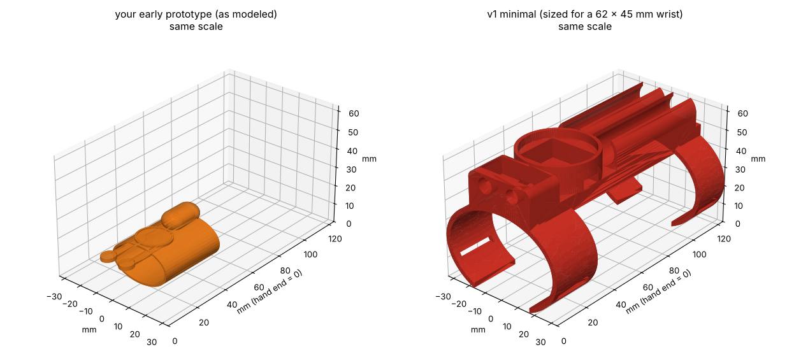

# Early prototype review

`early_prototype.obj` is the first Tinkercad mockup. Read as: a closed band, a pill-shaped capsule on top, a round screen in front of it, and two prongs with round tips reaching toward the hand. Those are the **two buttons**, meant to sit near the palm.

## What's good (kept in v1)
- **Layout order:** nozzles at the hand end → screen in the middle → capsule behind. Kept exactly.
- **Everything on one low spine** on top of the wrist. Kept.
- **Round screen**, which fits the look. Kept, sized for a real 1.28" round display.
- **Two buttons near the palm.** Kept, on a palm pad.

## What had to change
| Early prototype | Problem | v1 |
|---|---|---|
| Band is 33 × 25 mm inside | A real wrist is ~62 × 45 mm; this would fit a finger, not a wrist | Sized from `WRIST_WIDTH/HEIGHT` parameters |
| Closed ring | Can't slide over your hand (knuckles are ~85 mm wide) | Two slim C-bands open underneath, one strap each |
| Buttons on rigid prongs across the wrist joint | A rigid link locks the wrist so it can't bend | Two-button palm pad on an elastic hand loop, connected by a thin flexible cable |
| No nozzles | | Nozzles end flush at the front band, behind the wrist joint, so they never block the hand |
| Capsule ~12 × 18 mm (~1.4 mL) | Simulator: ~0.4 s of string per refill | Two 14 × 60 mm capsules (~6.8 mL each): ~2 s / ~12 m of string with a piston |
| Screen disc ~18 mm | Smallest real round displays are ~23 mm; electronics also need space | 40 mm boss: 36 mm display on top, ESP32 + battery underneath |
| No room for valves or wiring | | Valve pocket in the front block, wire channel under the screen |

## Honest trade-off
v1 is **16 mm tall** above the band (the early prototype was ~8 mm) and **124 mm long**. That's what real capsules, a real screen and real valves need. The biggest knob is `CAPSULE_LENGTH`: shorter means a smaller unit but less string per refill.
